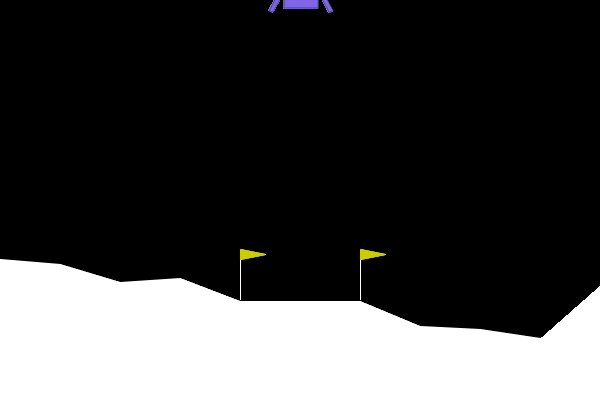
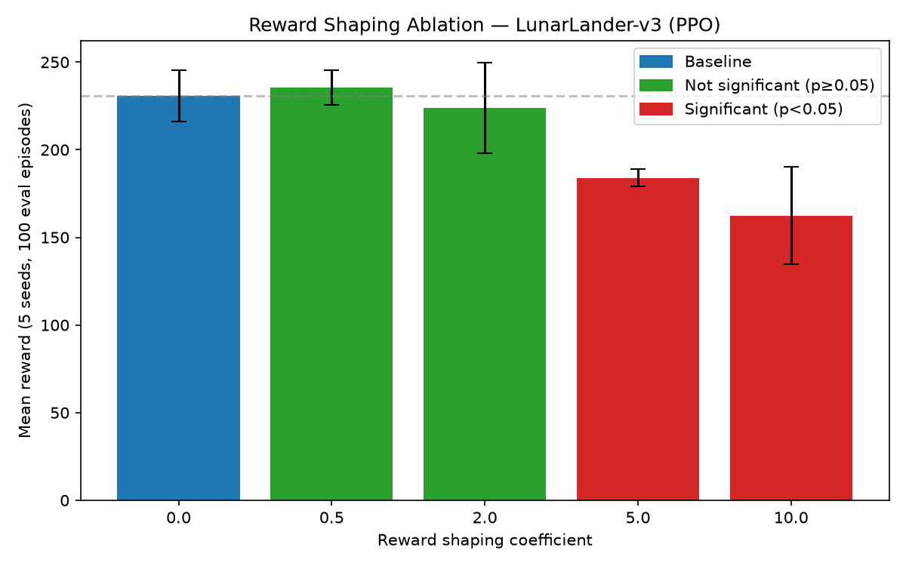
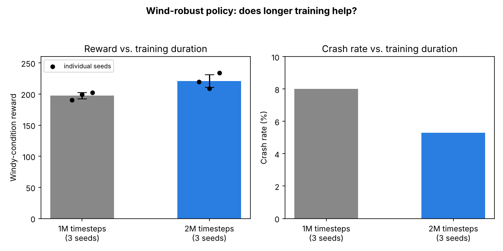
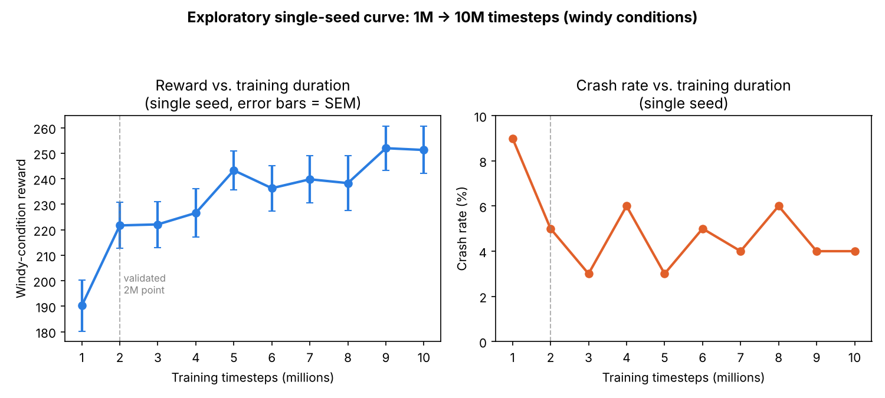

# Lunar Lander RL — PPO, Reward Shaping, and a Statistically Validated Ablation

Training an agent to land a rocket in Gymnasium's `LunarLander-v3` using Stable-Baselines3, then stress-testing a reward-shaping idea with a 5-seed ablation and Welch's t-tests rather than trusting a single lucky run.

## Setup

- Python 3.11 (3.14 breaks Box2D wheels)
- `python3.11 -m venv lander-env && source lander-env/bin/activate`
- `pip install "gymnasium[box2d]" "stable-baselines3[extra]" torch scipy`

## What this demonstrates

The core result here isn't "an RL agent that lands a rocket" — it's catching a false positive. A single-seed run made reward shaping look like an unambiguous win; a 5-seed ablation with Welch's t-tests showed that result didn't hold, and only strong shaping produced a statistically real effect. That's the same discipline validating any uncertain result requires before you act on it: don't trust an n=1 result, quantify the uncertainty, and test whether an observed difference is signal or noise.

## Results

**Baseline PPO** (1M timesteps, 8 envs): 154.7 ± 122.6 reward over 20 eval episodes.

**Algorithm comparison** (1M timesteps, single env, 20 episodes):
| Algorithm | Reward |
|---|---|
| PPO | 165.8 ± 94.8 |
| DQN | 6.1 ± 72.0 |
| A2C | 42.5 ± 130.4 |

**Reward shaping** (penalizing angular velocity): a single-seed run looked like a clear win (258.1 ± 15.4, 0% crash rate vs. baseline's 17%). Touchdown metrics backed it up: final |angular velocity| dropped from 0.072 to 0.000, final |angle| from 0.114 to 0.002.

**Continuous control** (`LunarLanderContinuous-v3`, 1M timesteps, 100 episodes): 238.8 ± 56.9.

### Does the shaping result hold up? — 5-seed ablation

Ran each coefficient × 5 random seeds (25 training runs, 1M timesteps each) and compared against the unshaped baseline with Welch's t-test:

| Coefficient | Mean reward | Crash rate | p-value vs. baseline | Cohen's d |
|---|---|---|---|---|
| 0.0 (baseline) | 230.9 ± 14.7 | 1.8% | — | — |
| 0.5 | 235.4 ± 9.9 | 1.2% | 0.6300 (not significant) | 0.36 (small) |
| 2.0 | 223.8 ± 25.9 | 2.8% | 0.6509 (not significant) | -0.34 (small) |
| 5.0 | 183.9 ± 4.9 | 8.8% | **0.0020 (significant)** | **-4.29 (large)** |
| 10.0 | 162.4 ± 27.7 | 8.2% | **0.0046 (significant)** | **-3.09 (large)** |

**Finding:** moderate shaping (coef ≤ 2.0) is statistically indistinguishable from baseline reward — the earlier single-seed "win" was a favorable outlier, not a real effect. Strong shaping (coef ≥ 5.0) significantly degrades reward and increases crash rate. This is the actual point of the exercise: a single seed can lie, and multi-seed validation with a significance test catches it.
Effect sizes corroborate the significance tests — the non-significant coefficients (0.5, 2.0) show small effect sizes (|d| < 0.4), while the significant ones (5.0, 10.0) show large effect sizes (|d| > 3).

### Does longer training help the wind-robust policy?

Trained 3 additional seeds at 2M timesteps (double the standard budget) and compared windy-condition performance against the 1M-timestep seeds:

| Training length | Windy reward (3-seed mean ± std) | Crash rate |
|---|---|---|
| 1M timesteps | 197.4 ± 5.2 | 7.0–9.0% |
| 2M timesteps | 220.9 ± 10.2 | 4.0–6.0% |

The improvement holds across every seed at 2M (219.6, 209.1, 234.0 — all above the 1M range of 190.2–202.6), consistent with the idea that a domain-randomized policy has a harder state space to cover and needs more samples to converge than a fixed-condition one.

**Exploratory: does the gain continue past 2M?** Ran one seed out to 10M timesteps with evaluation checkpoints every 1M steps (not a full multi-seed validation — treat as directional only):

| Timesteps | Reward | Crash rate |
|---|---|---|
| 1M | 190.2 | 9.0% |
| 2M | 221.7 | 5.0% |
| 5M | 243.3 | 3.0% |
| 10M | 251.3 | 4.0% |

The 1M→2M jump reproduces the validated finding above almost exactly (221.7 vs. the 3-seed-validated 220.9). Past 2M, reward gains flatten sharply (~15x lower reward-per-timestep than the first 1M) and crash rate stops improving, consistent with 2M being close to the point of diminishing returns for this policy. Not re-validated across seeds at these longer budgets, so treat the 5M–10M numbers as suggestive rather than confirmed.

## Files

- `train.py` — baseline PPO training
- `eval_baseline.py` — baseline evaluation
- `compare_algorithms.py` — PPO vs DQN vs A2C
- `reward_shaping.py` — angular-velocity-penalized reward wrapper
- `touchdown_metrics.py` — crash rate / final tilt / final angular velocity at touchdown
- `train_continuous.py` — continuous-action-space variant
- `reward_shaping_ablation_v2.py` — 5-seed × 5-coefficient ablation with Welch's t-tests

## Stack

Gymnasium, Stable-Baselines3 (PPO/DQN/A2C), PyTorch, SciPy, TensorBoard
