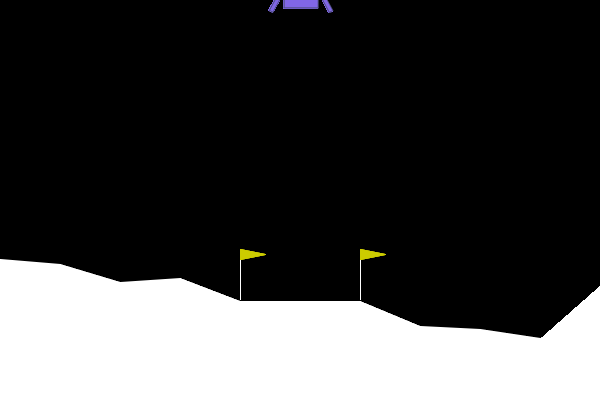
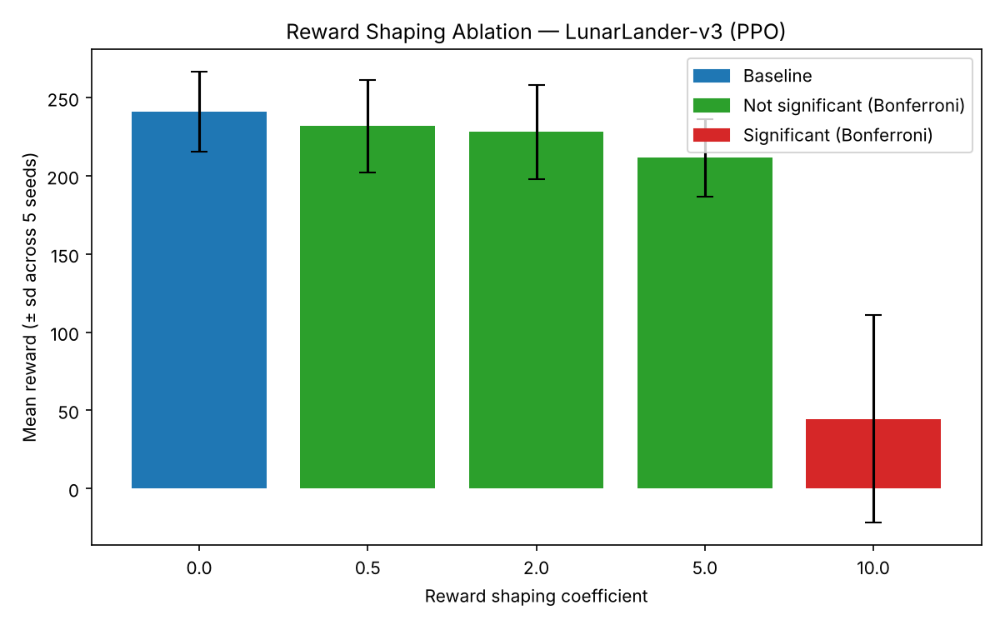
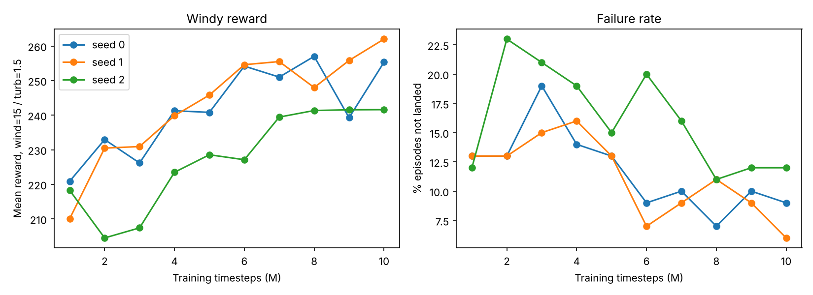

# Lunar Lander RL: PPO, Reward Shaping, and a Statistically Validated Ablation



I train an agent to land a rocket in Gymnasium's `LunarLander-v3` using Stable-Baselines3. Then I stress-test a reward-shaping idea with a 5-seed ablation and Welch's t-tests, instead of trusting a single lucky run.

## What this demonstrates

The core result here is catching false positives, more than "an RL agent that lands a rocket". A single-seed run made reward shaping look like a clear win. The 5-seed ablation with Welch's t-tests showed it wasn't. A second review then found that two of the supporting metrics, crash rate and final angular velocity, didn't measure what they claimed. Fixing them changed the numbers, and the conclusions moved with them. The discipline is the same throughout. Don't trust an n=1 result, quantify the uncertainty, and check that a metric measures what its name says.

## Setup

- Python 3.10+ (3.11 used originally; 3.14 breaks Box2D wheels)
- `python3.11 -m venv lander-env && source lander-env/bin/activate`
- `pip install -r requirements.txt` installs the direct dependencies (lower bounds) and the local `lander` package
- `requirements.lock.txt` is the original author's exact `pip freeze`, kept for exact reproduction only. Its pins (for example `torch==2.14.1`) may not resolve on every machine.
- `pytest` runs the tests

## How the numbers were measured (read this first)

**Outcomes.** Each evaluation episode is classified from the simulator state with the same tests the environment uses to end an episode (`src/lander/evaluation.py`):

| Outcome | Condition | Env terminal reward |
|---|---|---|
| landed | lander body asleep (came to rest) | +100 |
| crash | lander body touched the ground (`game_over`) | −100 |
| out_of_bounds | `|x| ≥ 1.0` (flew off the side) | −100 |
| timeout | hit the 1000-step `TimeLimit` without terminating | none |

The original code counted any episode with total reward < 0 as a crash. Across the 2,500 re-measured ablation episodes, that rule missed 55 of 107 real crashes, which had positive totals because approach shaping outweighed the −100. It also counted 75 timeouts and all 152 flyaways as crashes. CSVs still record that rule as `legacy_crash_rate`, for comparison.

**Landing gentleness.** The original "final |angular velocity|" was read at termination. A landed episode only terminates once the body is asleep, so its final ω is 0 by construction. Over the re-measured episodes it was 0.000 for landings and 0.227 for crashes. The metric mostly restated the crash rate. Tilt and ω are now sampled **at first leg-ground contact** and reported **over landed episodes only**.

**± and std.** Every ± below says which spread it is:
- *sd across episodes*: one trained model, spread over its evaluation episodes
- *sd across seeds*: spread of the per-seed mean rewards, sample std (`ddof=1`)

These are different quantities and shouldn't be compared with each other.

**Evaluation.** 100 deterministic episodes per model. Episode *i* is reset with seed *i*, so evaluations are reproducible. The original single-seed evaluations were unseeded.

**Re-measured vs original.** Results were re-measured on 2026-11-25/26 with gymnasium 1.4.0, stable-baselines3 2.9.2, torch 2.15.0 and Python 3.13, on CPU. Numbers tagged *original* come from the first run of this repo and were not re-measured. Their models were never committed, and the single-seed scripts were unseeded, so they can't be reproduced exactly.

## Results

All re-measured numbers are in `results/*.csv` (one row per run, plus every evaluation episode). The figures and statistics are generated from those files.

### Reward-shaping ablation (re-measured)



Penalty: `reward -= coef * |angular velocity|` on every step. 5 coefficients × 5 seeds = 25 PPO runs, 1M timesteps each, 8 training envs. Each run is evaluated on the **original** reward. `python experiments/04_shaping_ablation.py --workers 4`, then `python scripts/effect_size.py` and `python scripts/plot_ablation.py`.

| Coef | Mean reward (± sd across seeds) | Landed | Crash | Out of bounds | Timeout | Legacy "crash" (reward<0) | Welch p vs baseline | Cohen's d |
|---|---|---|---|---|---|---|---|---|
| 0.0 (baseline) | 241.0 ± 25.6 | 88.4% | 5.6% | 0.0% | 6.0% | 0.2% | — | — |
| 0.5 | 231.9 ± 29.6 | 87.2% | 5.4% | 0.0% | 7.4% | 2.6% | 0.62 | −0.33 (small) |
| 2.0 | 228.2 ± 30.2 | 88.2% | 4.2% | 0.0% | 7.6% | 2.2% | 0.49 | −0.46 (small) |
| 5.0 | 211.6 ± 24.9 | 90.6% | 3.2% | 0.0% | 6.2% | 2.8% | 0.10 | −1.16 (large) |
| 10.0 | 44.5 ± 66.3 | 46.8% | 3.0% | 30.4% | 19.8% | 48.0% | **0.0014** | **−3.91 (large)** |

Outcome rates are averaged over the 5 seeds (500 episodes per coefficient).

**Multiple comparisons.** There are 4 t-tests against one baseline, so the Bonferroni threshold is α = 0.05 / 4 = 0.0125. Coef 10.0 (p = 0.0014) passes it. Nothing else is significant even at an uncorrected 0.05.

**Landing gentleness**, landed episodes only, at first leg contact (means of per-seed means):

| Coef | \|ω\| at contact | \|angle\| at contact |
|---|---|---|
| 0.0 | 0.246 | 0.019 |
| 0.5 | 0.242 | 0.023 |
| 2.0 | 0.236 | 0.020 |
| 5.0 | 0.213 | 0.025 |
| 10.0 | 0.182 | 0.016 |

**Findings**
- Moderate shaping (coef ≤ 2.0) is statistically indistinguishable from baseline on reward and on outcome rates. The earlier single-seed "win" was a favorable draw.
- Shaping does not make landings meaningfully gentler at moderate strength: contact |ω| is 0.246 vs 0.236 at coef 2.0. The original "0.072 → 0.000" drop in final |ω| was the crash-rate artifact described above. Stronger shaping lowers contact |ω| (0.182 at coef 10), but at the cost of landing less than half the time.
- Strong shaping (coef 10.0) fails badly. The extra failures are mostly flyaways (30.4%) and timeouts (19.8%), not crashes. The old reward<0 rule reported them all as "crashes" (48%).
- **This disagrees with the original run on coef 5.0.** The original 5-seed ablation found 183.9 ± 4.9 (sd across seeds, `ddof=0`), p = 0.0020. The re-run finds 211.6 ± 24.9, p = 0.10. The effect size is still large (d = −1.16), and five seeds per arm has little power for an effect that size. So coef 5.0 is best described as "probably worse, not established". Only coef 10.0 is a robust degradation.
- Why moderate shaping is redundant: LunarLander's built-in shaping already contains `−100 · |angle|`. This penalty targets angular velocity, the time derivative of a quantity the default reward already penalizes, so little new signal reaches the agent until the penalty is large enough to compete with the landing objective.

**Original ablation (not re-measured, kept for the record):** 230.9 ± 14.7 / 235.4 ± 9.9 / 223.8 ± 25.9 / 183.9 ± 4.9 / 162.4 ± 27.7 for coefs 0 / 0.5 / 2 / 5 / 10. Those ± are sd across seeds with `ddof=0`. The reported Cohen's d (0.36, −0.34, −4.29, −3.09) used those population stds, which overstates |d| by √(5/4) ≈ 1.118. With `ddof=1` they become 0.32, −0.30, −3.84 and −2.76. The original "crash rates" used the reward<0 rule.

### Single-seed results (original, not re-measured)

- **Baseline PPO** (1M timesteps, 8 envs, unseeded): 154.7 ± 122.6 (sd across 20 episodes).
- **Shaped PPO, coef 2.0** (same setup): 258.1 ± 15.4 (sd across 20 episodes), with 0% vs 17% reward<0 "crash" rate on 100 episodes.

**Reconciling the three baseline numbers.** 154.7 (single-seed table), 165.8 (algorithm comparison) and 230.9 / 241.0 (ablation) are all 1M-step PPO baselines:
- 154.7 and 165.8 are single unseeded models, each scored on 20 unseeded episodes, with ± as sd across episodes. 165.8 used 1 training env instead of 8.
- 230.9 / 241.0 are 5-seed means of 100-episode evaluations, with ± as sd across seeds.

The number of evaluation episodes only affects noise, not the expected value. 154.7 is below all five re-measured baseline seeds (210.7–271.4), so the likeliest explanation is that particular unseeded model trained poorly. The same goes for the 17% vs 1.8% crash-rate gap: both used the reward<0 rule, on different models, so reclassification can't explain it.

### Algorithm comparison (re-measured)

1M timesteps, 1 training env, seed 0, 100 evaluation episodes. `python experiments/02_algorithm_comparison.py`

| Algorithm | Mean reward (± sd across episodes) | Landed | Crash | Out of bounds | Timeout |
|---|---|---|---|---|---|
| PPO | 218.1 ± 85.9 | 85% | 12% | 0% | 3% |
| DQN | 9.4 ± 57.7 | 8% | 0% | 0% | 92% |
| A2C | −15.5 ± 99.7 | 26% | 41% | 23% | 10% |

These are single-seed results, so the ranking is solid but the exact gaps are not. DQN's low score comes from hovering until the time limit (92% timeouts) rather than crashing. The reward<0 rule called 58% of its episodes "crashes", yet it crashed 0 times.

Original (20 unseeded episodes, sd across episodes): PPO 165.8 ± 94.8, DQN 6.1 ± 72.0, A2C 42.5 ± 130.4.

### Continuous control (re-measured)

`LunarLanderContinuous-v3`, 1M timesteps, 8 envs, seed 0, 100 episodes. `python experiments/06_continuous.py`

216.2 ± 85.4 (sd across episodes): 85% landed, 15% crash. Single seed.

Original: 238.8 ± 56.9 (sd across 100 episodes).

### Wind robustness vs training duration (re-measured, 3 seeds)



PPO is trained on randomized wind (wind_power ∈ [0, 20], turbulence ∈ [0, 2], new draw every episode) and evaluated every 1M steps for 10M steps. `python experiments/05_wind_robust.py --seeds 0 1 2 --n-chunks 10 --workers 3`

Evaluation uses a **single point** of the training range, wind_power = 15.0 and turbulence = 1.5. So these numbers describe that condition, not "windy conditions" in general.

| Timesteps | Seed 0 | Seed 1 | Seed 2 | Mean ± sd across seeds | Not landed (per seed) |
|---|---|---|---|---|---|
| 1M | 220.9 | 210.1 | 218.3 | 216.4 ± 5.6 | 12–13% |
| 2M | 233.0 | 230.5 | 204.5 | 222.6 ± 15.8 | 13–23% |
| 5M | 240.8 | 245.8 | 228.6 | 238.4 ± 8.9 | 13–15% |
| 10M | 255.3 | 262.0 | 241.6 | 253.0 ± 10.4 | 6–12% |

**Findings**
- **The 1M → 2M gain did not replicate.** The original run found 197.4 ± 5.2 → 220.9 ± 10.2 (3 seeds, `ddof=0`), "improving on every seed". The re-run finds 216.4 → 222.6, with one seed getting worse (paired t-test p = 0.61).
- **Longer training does help, more slowly than first reported.** All three seeds improve from 1M to 10M (+37 on average). The share of episodes not landed only drops clearly by 10M. The original single-seed 10M curve (190.2 → 251.3) is now backed by 3 seeds.
- The wind wrapper now draws from the environment's seeded `self.np_random` instead of the global NumPy RNG. Re-runs therefore don't replay the original wind sequence, and that is one reason these numbers differ from the original run.

## Layout

```
src/lander/
  wrappers.py        CustomRewardWrapper, RandomWindWrapper
  evaluation.py      outcome classifier, per-episode metrics, CSV helpers
  stats.py           Cohen's d (ddof=1), Welch's t-test
experiments/
  01_baseline.py               02_algorithm_comparison.py
  03_shaping_single_seed.py    04_shaping_ablation.py
  05_wind_robust.py            06_continuous.py
scripts/
  effect_size.py     ablation statistics from results/ablation_runs.csv
  plot_ablation.py   figures from results/*.csv
  record_gif.py  watch_policy.py  test_env.py
results/             CSVs written by the experiments
figures/             plots and landing.gif
tests/               pytest suite (classifier agrees with the env's terminal reward, ddof=1, seeded wind)
```

Every script takes `--help`. Trained models go to `models/`, which git ignores. `figures/landing.gif` was recorded from the original single-seed shaped model.

## Stack

Gymnasium, Stable-Baselines3 (PPO/DQN/A2C), PyTorch, SciPy, Matplotlib

## License

MIT, see [LICENSE](LICENSE).
